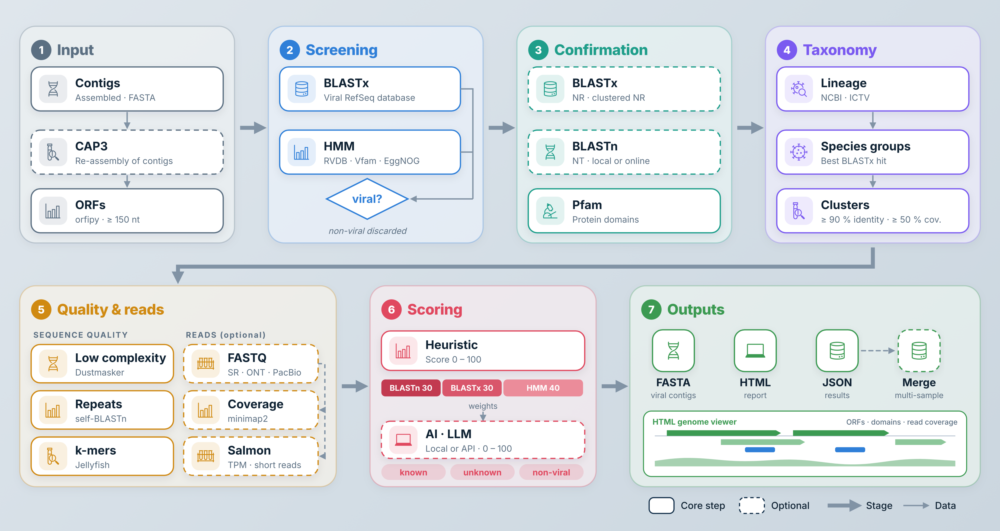
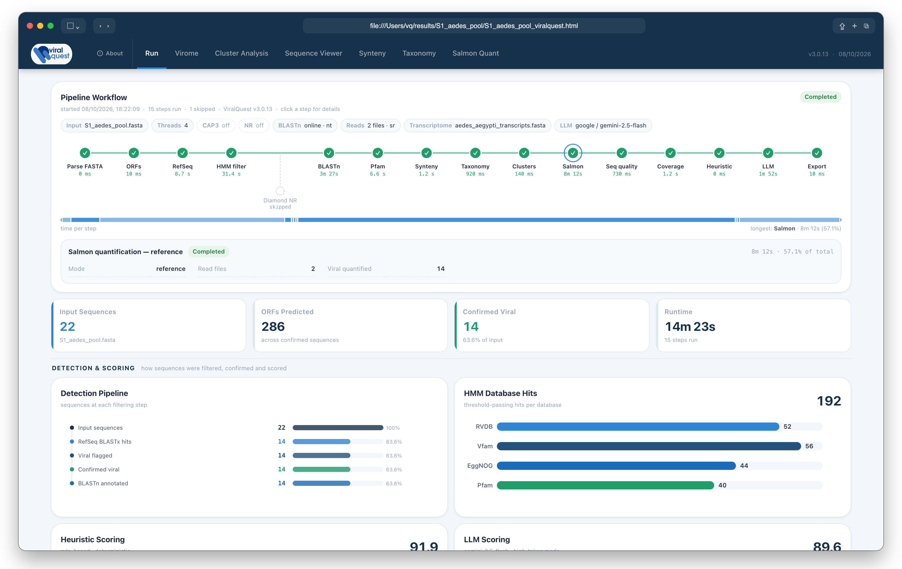
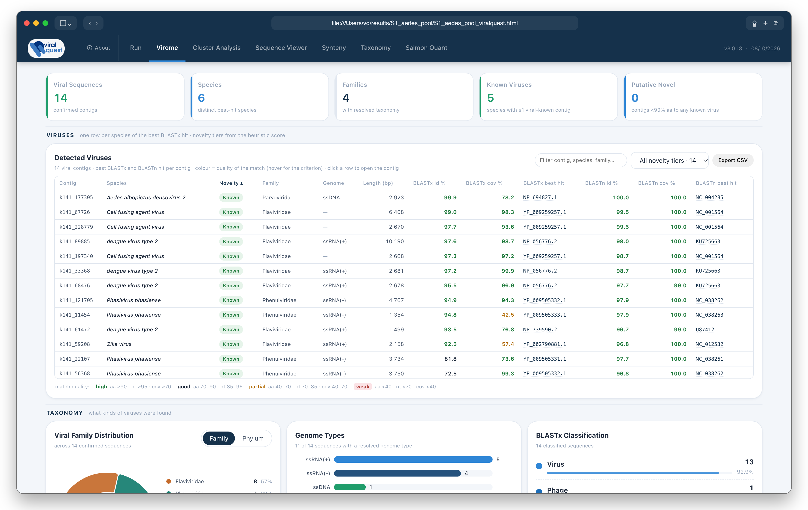
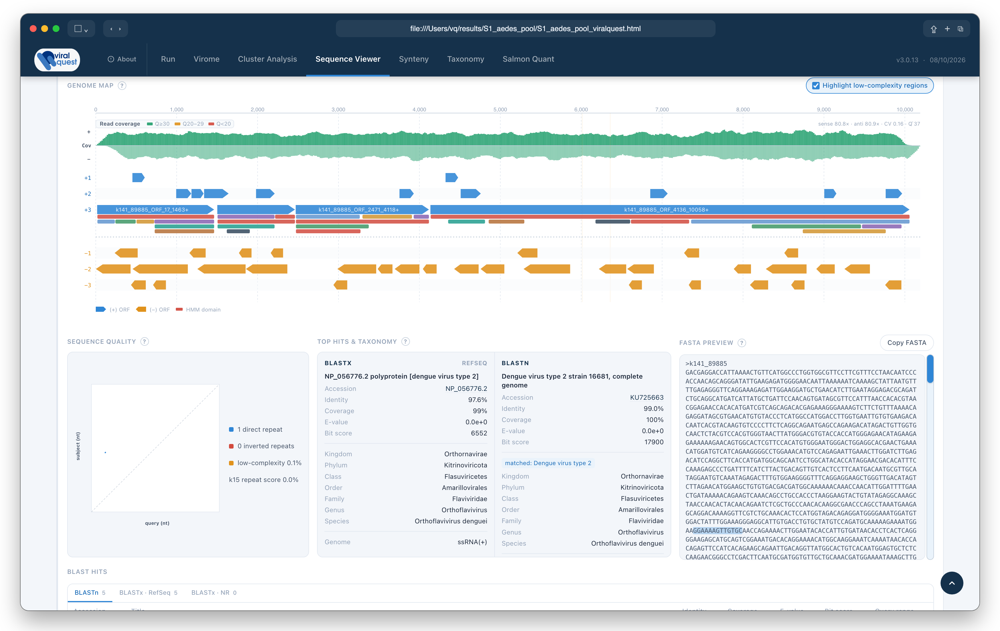
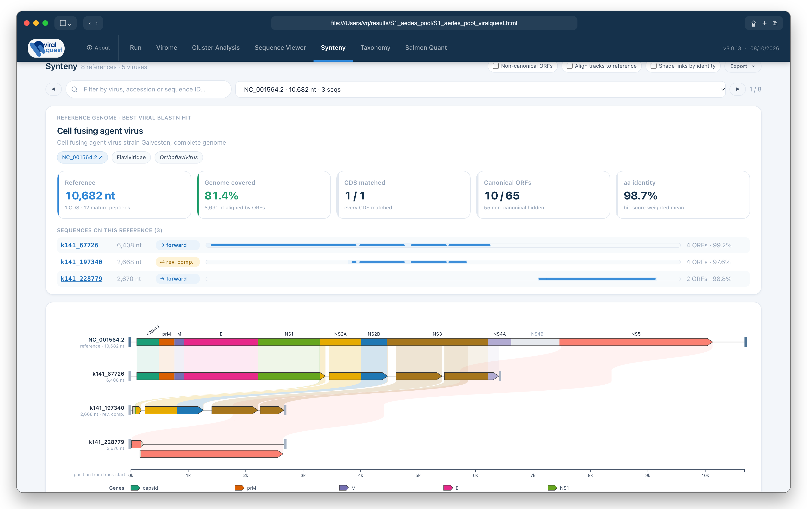
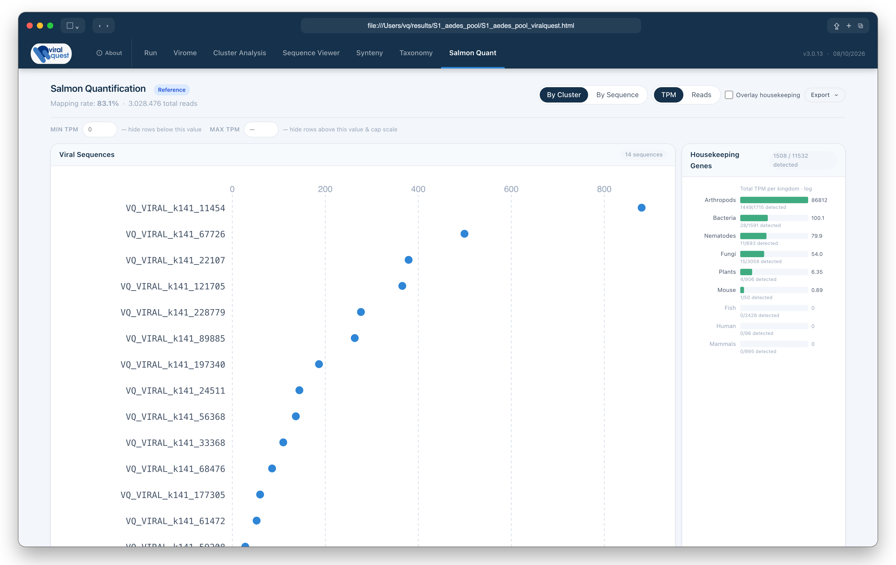
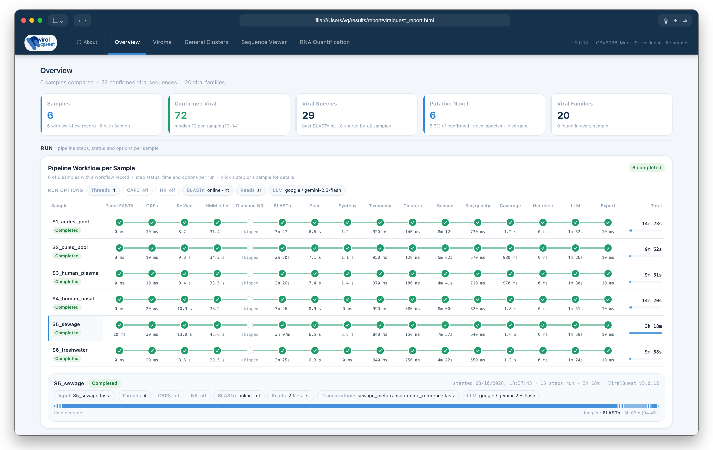
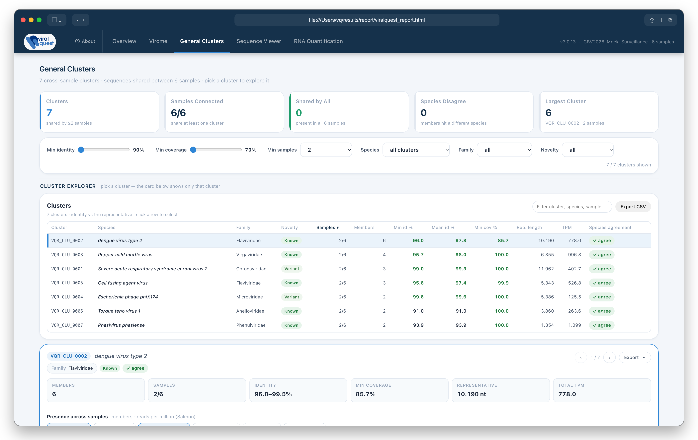
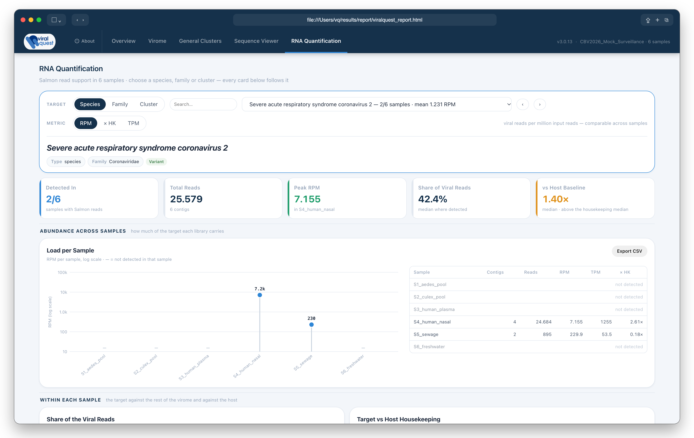

<div align="center">
  
  <br><br>
  <strong>A pipeline for viral diversity analysis from assembled contigs</strong>
  <br><br>
  
  
  
</div>

---

## Overview

ViralQuest detects and characterizes viral sequences from assembled metagenomics or transcriptomics contigs. The pipeline integrates:



Paper: [https://link.springer.com/article/10.1186/s12859-026-06391-6](https://link.springer.com/article/10.1186/s12859-026-06391-6)

---

## Installation

### 1. Create a conda environment

Create a new conda environment to manage all required packages.

```bash
conda create -n viralquest python
```

After create the new env, use `conda activate viralquest` to run the next steps.

### 2. Clone the repository and install the environment

```bash
git clone https://github.com/gabrielvpina/viralquest.git
cd viralquest
pip install -e .
```

`pip install -e .` installs the Python package and registers the CLI entry points.

### 3. Install dependencies and databases

```bash
viralquest-setup
```

`viralquest-setup` performs the full first-time setup in a single command:

1. Verifies that pixi is available; installs it automatically if not.
2. Runs `pixi install` if the environment is not yet built.
3. Downloads reference databases from Zenodo into `data/` (HMM profiles: RVDB, Vfam, EggNOG, Pfam; viral Diamond filter DB).

To update or re-download databases **independently**:

```bash
viralquest-download           # skips files already present
viralquest-download --force   # re-downloads all files
```

---

## External databases (user-provided)

These are optional but required for full pipeline runs.

| Database | Purpose | Approx. size |
|---|---|---|
| `nr.dmnd` | Diamond BLASTx NR confirmation | ~346 GB |
| BLAST `nt` | BLASTn local search | ~1 TB |
| `clustered_nr.dmnd` *(compact alternative to NR)* | Diamond BLASTx NR confirmation | ~263 GB BLAST db (~194 GB download) |
| BLAST `core_nt` *(compact alternative to nt)* | BLASTn local search | ~301 GB (~256 GB download) |

Build NR Diamond database:

```bash
wget https://ftp.ncbi.nlm.nih.gov/blast/db/FASTA/nr.gz
gunzip nr.gz
diamond makedb --in nr --db nr.dmnd
```

BLASTn can also run online (`--blastn-online`); the NR step is optional.

### Compact alternatives: ClusteredNR and core_nt

If disk space or search time is a constraint, NCBI publishes two smaller
databases that can replace NR and nt:

- **ClusteredNR (`clustered_nr`)** — NR with near-identical proteins clustered
  together (~546 million representatives instead of ~1.16 billion sequences).
  Each hit is the cluster's representative, so the reported subject/species may
  be a close relative of the sequence that would hit in the full NR.
- **core_nt** — nt without most of the large eukaryotic genome-assembly records
  that make up the bulk of nt (~301 GB instead of ~1.2 TB).

Both are distributed as pre-formatted BLAST databases, downloaded with
`update_blastdb.pl` (part of BLAST+, installed by `viralquest-setup`).
ClusteredNR must be exported to FASTA before building the Diamond database:

```bash
# ClusteredNR → Diamond database for -nr / --nr-db
update_blastdb.pl --decompress clustered_nr
blastdbcmd -db clustered_nr -entry all -out clustered_nr.fasta
diamond makedb --in clustered_nr.fasta --db clustered_nr.dmnd

# core_nt → used directly by -n / --blastn-local (pass the database prefix)
update_blastdb.pl --decompress core_nt
```

```bash
viralquest -in SAMPLE.fasta -out SAMPLE_output \
  --nr-db clustered_nr.dmnd \
  --blastn-local /path/to/core_nt
```

---

## Usage

Minimal run:

```bash
viralquest \
  -in   SAMPLE.fasta \
  -out  SAMPLE_output \
  -cpu  8
```

Full run with NR, local BLASTn, Salmon, and local LLM:

```bash
viralquest \
  -in            SAMPLE.fasta \
  -out           SAMPLE_output \
  -nr            /path/to/nr.dmnd \
  -n             /path/to/nt \
  --transcriptome host_transcriptome.fasta \
  --reads         R1.fastq R2.fastq \
  --read-type     sr \
  --hk-genes      housekeeping_ids.txt \
  --model-type    ollama \
  --model-name    qwen3:4b \
  --llm-tokens    low \
  -cpu            8 \
  --live
```

### Arguments

#### Required

| Argument | Description |
|---|---|
| `-in` | Input FASTA (assembled contigs) |
| `-out` | Output directory (created if absent) |

#### Pipeline tuning

| Argument | Description |
|---|---|
| `-cpu` | CPU threads for Diamond, HMMsearch, BLASTn, and Salmon (default: 2) |
| `--cap3` | Run CAP3 assembly before the pipeline |
| `--min-identity` | Minimum % identity for intra-cluster BLASTn alignment (default: 90.0) |
| `--min-coverage` | Minimum query coverage (%) for a sequence to qualify as a cluster member (default: 50.0); clusters with fewer than 2 qualifying members are dropped |
| `--force` | Export all sequences, ignoring viral confirmation filters |

#### Databases

| Argument | Description |
|---|---|
| `-nr` / `--nr-db` | Diamond-format NR database (optional) |
| `--nr-block-size` | GB of RAM per Diamond database pass (default: Diamond built-in ~2.0) |
| `--nr-index-chunks` | Diamond seed-index chunks; lower = fewer disk passes, higher RAM (default: 4) |
| `--nr-tmpdir` | Directory for Diamond temporary files (e.g. `/dev/shm` for RAM disk) |
| `--db-dir` | Flat directory containing all five binary database files; overrides the bundled `data/` layout |

#### BLASTn (choose one)

| Argument | Description |
|---|---|
| `-n` / `--blastn-local` | Path to a local BLAST nucleotide database |
| `--blastn-online` | NCBI e-mail for qblast (no local DB required); captures accession and query coordinates |
| `--blastn-online-db` | NCBI database for online BLASTn (default: `nt`) |

#### Read-based analysis (reads → Salmon + coverage)

Supplying `--reads` enables two read-based modules: **Salmon quantification** (short reads only) and **read-coverage profiling** (minimap2, all read types). `--read-type` is required whenever `--reads` is used.

| Argument | Description |
|---|---|
| `--reads` | FASTQ file(s): one = single-end, two = paired-end |
| `--read-type` | Read technology, required with `--reads`: `sr` (Illumina), `ont` (Nanopore), `pb` (PacBio CLR), `hifi` (PacBio HiFi). Salmon quantification runs for `sr` only; with `ont`/`pb`/`hifi` the Salmon step is skipped (its short-read mapping is invalid for long reads) and only minimap2 read coverage is produced. |
| `--transcriptome` | Host transcriptome FASTA; enables the Salmon reference pathway |
| `--hk-genes` | Text file of reference housekeeping gene IDs (one per line) for normalization; requires `--transcriptome` |
| `--low-memory` | Low-RAM mode for the Salmon index (`-k 21`, and in de-novo mode drops background contigs < 500 bp). Use when `salmon index` runs out of memory |
| `--skip-salmon` | Skip Salmon quantification but still run read coverage (incl. sense/antisense) and sequence-quality checks |

#### Sequence quality (always on)

Structural checks on the confirmed viral sequences (dustmasker low-complexity, self-BLASTn repeats, jellyfish k-mer score, dot plot). These are computed from the assembled sequences alone, so they **run in every mode — `--reads` is not required**.

| Argument | Description |
|---|---|
| `--kmer` | k-mer size for the jellyfish repetitiveness score (default: 15) |
| `--skip-seq-quality` | Skip the sequence-quality module entirely (saves the self-BLASTn / dot-plot time on runs with many or very long contigs) |

#### LLM scoring

| Argument | Description |
|---|---|
| `--model-type` | Provider: `ollama`, `openai`, `anthropic`, `google` |
| `--model-name` | Model identifier (e.g. `qwen3:4b`, `gpt-4o`, `gemini-2.5-pro`) |
| `--llm-tokens` | Prompt mode: `high` (all hits, full details) or `low` (best hits only, compact) |
| `--api-key` | API key for cloud providers (not required for Ollama) |

#### Output / misc

| Argument | Description |
|---|---|
| `--live` | Rich Live display: ASCII banner + scrolling log box + step progress bar |
| `-v` / `--version` | Print version and exit |
| `-h` / `--help` | Show formatted help and exit |

---

## Output

```
SAMPLE_output/
├── features/                        # every alignment / analysis table
│   ├── diamond/
│   │   ├── refseq.tsv               #   Diamond BLASTx vs viral RefSeq filter
│   │   └── nr.tsv                   #   Diamond BLASTx vs NR (if --nr-db provided)
│   ├── hmm/                         #   RVDB.tsv · Vfam.tsv · EggNOG.tsv · Pfam.tsv
│   ├── blastn/
│   │   └── blastn.tsv               #   BLASTn hits (local or online)
│   ├── synteny/                     #   vs each best viral BLASTn reference (unless --no-synteny)
│   │   ├── refs/<accession>.gb      #     cached GenBank records
│   │   └── synteny.tsv              #     ORF ↔ reference CDS blastp hits
│   ├── seq_quality/                 #   unless --skip-seq-quality
│   │   ├── <seq_id>.tsv             #     per-feature: low-complexity + self-repeats
│   │   └── summary.tsv              #     per-sequence scalars (low-cx frac, k-mer score…)
│   └── cap3/                        #   CAP3 assembly (if --cap3)
├── reads/                           # read-based data (if --reads)
│   ├── coverage/<seq_id>.tsv        #   bin · position · mean/sense/antisense depth
│   ├── mapping/
│   │   ├── viral_mapped.bam(.bai)   #   reads aligned to the confirmed viral sequences
│   │   └── mapped_R1/R2.fastq.gz    #   reads that mapped (mapped.fastq.gz for single files)
│   ├── salmon/                      #   Salmon index and quant output (short reads)
│   ├── coverage_summary.tsv         #   depth, breadth, uniformity per sequence
│   ├── quantification.tsv           #   every Salmon target (viral, reference HK, conserved HK, host)
│   └── host_viral_hits.tsv          #   host transcripts similar to viral sequences (reference pathway)
├── fastas/
│   ├── SAMPLE_viral_contigs.fasta   #   every confirmed viral sequence
│   └── SAMPLE_<tier>.fasta          #   one per novelty tier present: known, variant,
│                                    #   novel-species, divergent, highly-divergent
├── SAMPLE_viralquest.json           # full structured report (JSON)
├── SAMPLE_viralquest.html           # self-contained interactive HTML report
├── SAMPLE_viralquest.xlsx           # aggregated results, one sheet per table (see below)
├── SAMPLE_viralquest.sqlite         # the consolidated report's tables, for this one sample
└── viralquest.log                   # full pipeline log
```

The **results workbook** (`SAMPLE_viralquest.xlsx`) has one sheet per table: *Sequences* (one row per sequence: taxonomy, domains, best BLASTn / BLASTx hit), *Classification* (heuristic / LLM scores, novelty tier, cluster), *Taxonomy*, *ORFs*, *Domains*, *BLASTx hits*, *BLASTn hits*, *Clusters*, *Synteny*, *Contig quality*, *Genome coverage*, *Quantification* and *Host-viral hits*. Accessions link to their NCBI record.

The **SQLite file** uses the schema of the multi-sample report's `.sqlite` (`sequences`, `blastx_hits`, `blastn_hits`, `blastn_taxonomy`, `orfs`, `domains`, `clusters`, `cluster_members`, `coverage`, `seq_quality`, `synteny_hits`, `quantification`, `host_viral_hits`) without the dataset and sample tables and columns: rows are keyed by `seq_id`.

### Exploring the results with SQLite

The `.sqlite` file is a small database: each table works like a spreadsheet tab, and you ask questions with **SQL** queries instead of filtering by hand. Tables are linked by `seq_id` (the contig name), so information from different tables can be combined.

**Open it.** No server or installation beyond the `sqlite3` command (bundled with macOS and most Linux distributions; on conda: `conda install sqlite`). For a point-and-click view, [DB Browser for SQLite](https://sqlitebrowser.org/) opens the same file.

```bash
sqlite3 -header -column SAMPLE_viralquest.sqlite
```

Inside the prompt, `.tables` lists the tables, `.schema sequences` shows a table's columns, and `.quit` exits. Every query ends with `;`.

**Example questions:**

```sql
-- The five highest-scoring sequences
SELECT seq_id, family, species, novelty, heuristic_score
FROM sequences
ORDER BY heuristic_score DESC
LIMIT 5;

-- How many sequences per viral family
SELECT family, COUNT(*) AS n_sequences
FROM sequences
GROUP BY family
ORDER BY n_sequences DESC;

-- Best BLASTx hit of each sequence (JOIN combines two tables through seq_id)
SELECT s.seq_id, s.species, b.subject_title, b.pct_identity
FROM sequences AS s
JOIN blastx_hits AS b ON b.seq_id = s.seq_id
WHERE b.rank = 1 AND b.source = 'refseq';

-- Putative new viruses and how well the reads cover them
SELECT s.seq_id, s.novelty, c.mean_depth, ROUND(c.breadth_1x * 100, 1) AS breadth_pct
FROM sequences AS s
JOIN coverage AS c ON c.seq_id = s.seq_id
WHERE s.novelty IN ('novel-species', 'divergent', 'highly-divergent')
ORDER BY c.mean_depth DESC;

-- Strongest Pfam domains
SELECT seq_id, orf, target, e_value
FROM domains
WHERE database = 'Pfam'
ORDER BY e_value
LIMIT 10;
```

To save a result as a spreadsheet-friendly file, add `.mode csv` and `.output families.csv` before the query (`.output` alone switches back to the screen).

**From Python or R** the same queries return a data frame:

```python
import sqlite3, pandas as pd
con = sqlite3.connect("SAMPLE_viralquest.sqlite")
families = pd.read_sql("SELECT family, COUNT(*) AS n FROM sequences GROUP BY family", con)
```

```r
library(DBI)
con <- dbConnect(RSQLite::SQLite(), "SAMPLE_viralquest.sqlite")
families <- dbGetQuery(con, "SELECT family, COUNT(*) AS n FROM sequences GROUP BY family")
```

The multi-sample report's database has the same tables plus `samples` and a `sample` column, so the questions can be asked across samples (there, tables are linked by `gid`, written `sample::seq_id`):

```sql
-- Viruses found in more than one sample, with their total abundance (reads per million)
SELECT species, COUNT(DISTINCT sample) AS n_samples, ROUND(SUM(rpm), 1) AS total_rpm
FROM sequences
GROUP BY species
ORDER BY n_samples DESC, total_rpm DESC;
```

The HTML report is fully self-contained (single file, no external dependencies) and includes:

- **Run** — pipeline workflow (status and time per step, run options), detection funnel, HMM hits, heuristic and LLM scoring
- **Virome** — detected viruses per contig with novelty tiers and match quality, family / genome-type / classification summaries
- **Cluster analysis** — sequence grouping with representative sequences and member alignment stats
- **Sequence viewer** — per-sequence genome map with lane-packed ORF frames (+1/+2/+3/−1/−2/−3), HMM domain overlays, a two-sided read-coverage track (sense up / antisense down, coloured by base quality), tabbed BLAST hit tables (BLASTn / BLASTx-RefSeq / BLASTx-NR), sequence-quality panels (low-complexity bands + repeat dot plot), LLM analysis text, and FASTA / sequence-table (TSV, XLSX) export
- **Synteny** — gggenomes-style map of the contigs against their best viral BLASTn reference: ORFs coloured by reference gene (or mature peptide), blastp links between reference and contigs and between contigs, segmented viruses grouped by organism, large genomes zoomed to the covered region; *Hide links* leaves only the gene colours (tracks aligned to the reference) when many sequences share one map
- **Taxonomy tree** — D3 radial tree built from phylum → order → family → genus → sequence
- **Salmon quantification** — viral expression boxplots grouped by cluster, housekeeping gene bar charts per kingdom, host–viral similarity table (EVE detection)

### Screenshots












---

## Read-based analysis

When `--reads` is supplied, two modules run on the confirmed viral sequences in addition to the assembly-based analysis: Salmon quantification and read-coverage profiling. Both are optional and share the same read input; `--read-type` selects the sequencing technology.

### Read coverage

Confirmed viral sequences are used as a small reference and the reads are aligned with **minimap2** (technology-aware preset per `--read-type`: `sr` → short read, `ont` → `map-ont`, `pb` → `map-pb`, `hifi` → `map-hifi`). A single `samtools mpileup` pass yields, per base:

- **total depth** plus a **sense / antisense strand split** (forward- vs reverse-mapping reads);
- **mean base quality** (Phred), used to colour the coverage track (green ≥ Q30, amber Q20–29, red < Q20).

In the HTML viewer this renders as a two-sided track under the ORF lanes (sense grows up, antisense down). A roughly uniform profile indicates a well-assembled contig; an internal coverage discontinuity flags a possible chimeric / mis-assembled junction. Per-sequence depth is also exported to `reads/coverage/<seq_id>.tsv`, and the alignment itself is kept in `reads/mapping/` (BAM plus the mapped reads as FASTQ). Coverage runs for **any** read type — it is the read signal used when Salmon is skipped for long reads or via `--skip-salmon`.

## Sequence quality

Structural checks on the confirmed viral contigs, written to `features/seq_quality/`. They derive only from the assembled sequences, so this module **runs in every execution — with or without `--reads`** (disable it with `--skip-seq-quality`):

- **dustmasker** — low-complexity regions (shown as bands in the viewer);
- **self-BLASTn** — internal direct and inverted repeats, visualised as a dot plot (slope +1 direct, −1 inverted);
- **jellyfish** — a k-mer repetitiveness score (k set by `--kmer`, default 15).

These flag assembly artefacts and repeat structure that can otherwise inflate or distort downstream interpretation. Each tool degrades gracefully: a missing binary only drops its own signal.

## Salmon quantification

Two pathways are available depending on whether a reference transcriptome is provided.

**Reference pathway** (`--transcriptome` + `--reads`): builds a combined Salmon index from viral sequences + bundled multi-kingdom housekeeping genes + user transcriptome. BLASTn of the transcriptome against viral sequences detects potential endogenous viral elements (EVEs).

**De-novo pathway** (`--reads` only): BLASTn of bundled housekeeping genes against the assembled contigs identifies normalization anchors; the full contig set is quantified directly.

Bundled housekeeping genes cover seven kingdoms: mammals, arthropods, plants, fish, fungi, bacteria, and nematodes.

---

## Scoring

Every run produces a **heuristic score** for each exported sequence, and can optionally add an **LLM score** on top.

### Heuristic scoring (always on)

A deterministic, rule-based scorer runs automatically at the end of every pipeline — **no LLM, no NR database, and no API key required**. It scores exactly the set of sequences the report emits, so a `vq_score` is always present for each exported sequence even in fully offline runs. It requires no configuration or extra arguments.

### LLM scoring (optional)

Runs on the same set of confirmed sequences the report emits: NR-confirmed sequences in the `--nr-db` pathway, or RefSeq/HMM-confirmed (`is_viral`) sequences when NR is not used — and all sequences under `--force`. The Google backend uses the [`google-genai`](https://googleapis.github.io/python-genai/) package (`google-genai>=1.0.0`).

```bash
# Local (Ollama) — minimum recommended model: qwen3:4b
--model-type ollama --model-name qwen3:4b --llm-tokens low

# Cloud API
--model-type google  --model-name gemini-2.5-flash --api-key YOUR_KEY --llm-tokens low
--model-type openai  --model-name gpt-4o           --api-key YOUR_KEY --llm-tokens high
--model-type anthropic --model-name claude-sonnet-4-6 --api-key YOUR_KEY --llm-tokens high
```

Output per sequence: `vq_score` (0–100), `classification` (`viral-known` / `viral-unknown` / `non-viral`), and a free-text analysis paragraph.

Setup guide: [wiki/Setup-AI-Summary-resource](https://github.com/gabrielvpina/viralquest/wiki/Setup-AI-Summary-resource)

---

## Multi-sample consolidated report (`viralquest-report`)

`viralquest-report` merges several individual ViralQuest runs into a **single interactive HTML report**, with cross-sample clustering of the confirmed viral sequences. Point it at a directory containing one subdirectory per run (each holding its `*_viralquest.json`):

```bash
viralquest-report \
  -in   results_dir/ \
  -out  consolidated_report/ \
  -n    PRJNA123456
```

Each run is a named **dataset** (`-n`: a BioProject, a host species, a study …). Besides the HTML, the output directory holds:

| File | Content |
|---|---|
| `viralquest_report.html` | Self-contained interactive report |
| `<name>.viralquest.json` | Full report data — dataset name, schema version, per-sample summaries, every sequence record, cross-sample clusters |
| `<name>.viralquest.sqlite` | The same data as tables: `dataset_info`, `samples`, `sequences`, `blastx_hits`, `blastn_hits`, `blastn_taxonomy`, `orfs`, `domains`, `clusters`, `cluster_members`, `coverage`, `seq_quality`, `synteny_hits`, `quantification`, `host_viral_hits` |
| `<name>.viralquest.xlsx` | The results workbook of a single run over every sample (a *Sample* column on each sheet), plus *Samples*, *General clusters* (the cross-sample clusters; the per-sample ones are in *Sample clusters*) and *General synteny* |
| `fastas/` | `<name>_viral_contigs.fasta` with every sequence (headers `sample::seq_id`), one `<name>_<tier>.fasta` per novelty tier, and `clusters/<VQR_CLU_####>.fasta` |
| `reads/` | `coverage_summary.tsv`, `quantification.tsv` and `host_viral_hits.tsv` over every sample, and `clusters/<VQR_CLU_####>.tsv` (per-cluster quantification) |
| `features/blastn/general_blastn.tsv` | Member ↔ representative BLASTn of the cross-sample clusters |
| `features/synteny/` | General synteny: the pooled reference GenBank records, reference ↔ reference and ORF ↔ reference DIAMOND blastp, `synteny.tsv` |

**General synteny.** The reference genomes each sample's synteny step picked are pooled and compared to each other (DIAMOND blastp of all their proteins): references of one virus — strains, isolates, partial records — form one group (≥ 80 % aa identity over ≥ 50 % of a proteome by default). Every sequence of a group, from any sample, is aligned again to the group's anchor reference (the one most sequences used), with contig ↔ contig links across samples. The *General Synteny* tab draws each group like a single run's Synteny tab, with the sample of each track.

Every SQLite row carries the `dataset` column and every primary key starts with it, so datasets can be combined later without id clashes (sample, contig and cluster ids are only unique within one dataset):

```sql
-- merge dataset B into a copy of dataset A
ATTACH 'B.viralquest.sqlite' AS b;
INSERT INTO dataset_info SELECT * FROM b.dataset_info;
INSERT INTO samples      SELECT * FROM b.samples;
INSERT INTO sequences    SELECT * FROM b.sequences;
-- … same for the other tables (quantification / host_viral_hits are keyed by dataset + sample)
```

### Arguments

| Argument | Description |
|---|---|
| `-in` / `--input` | Directory containing ViralQuest result directories (each with a `*_viralquest.json`) |
| `-out` / `--outdir` | Output directory for the consolidated report |
| `-n` / `--name` | **Required.** Dataset name (1–64 letters, digits, `.`, `_`, `-`); names the JSON / SQLite exports and tags every row |
| `--min-identity` | BLASTn identity floor for cross-sample clusters |
| `--min-coverage` | BLASTn coverage floor for cross-sample clusters |
| `--blastn-bin` | `blastn` binary to use (default: `blastn`) |
| `--no-clusters` | Skip cross-sample clustering (Overview + Viewer only) |
| `--no-synteny` | Skip the general synteny |
| `--synteny-identity` / `--synteny-coverage` | aa identity / proteome coverage for two references to share a group (defaults 80 / 50; `--synteny-identity 70` groups at about genus level) |
| `-cpu` / `--cpu` | DIAMOND threads for the general synteny (default 2) |
| `--email` | E-mail sent to NCBI if a reference GenBank record is not in any sample folder |
| `--version` | Print version and exit |

### Screenshots






